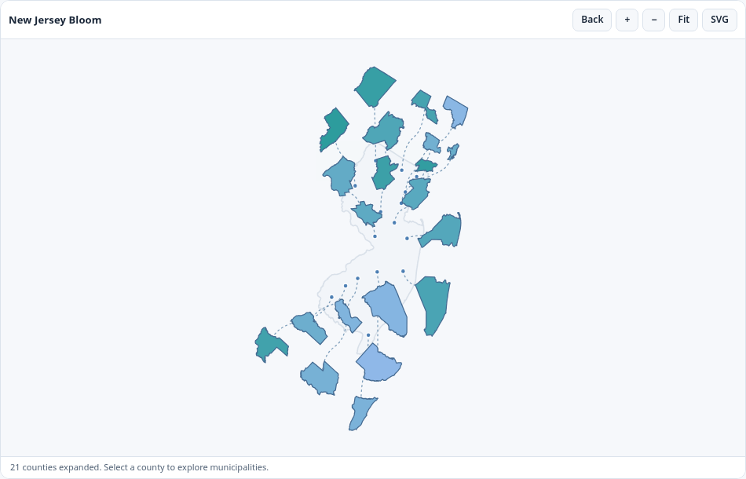

# bloomr 

**Interactive maps that keep geography in view.**

[Website](https://prigasg.github.io/bloomr/) · [Get started](https://prigasg.github.io/bloomr/articles/getting-started.html) · [Function reference](https://prigasg.github.io/bloomr/reference/index.html)

`bloomr` spreads geographic areas apart so you can explore them without losing their original locations. Dots and dotted lines connect each area to its position on the map. Use it in R, an HTML report, or a Shiny dashboard, with no JavaScript or CSS setup.

If you know [dragmapr](https://CRAN.R-project.org/package=dragmapr) or [explodemap](https://CRAN.R-project.org/package=explodemap), those packages explore related ways to move geographic areas for display. `bloomr` focuses on interactive parent-to-child expansion with visible origin dots and connectors.

## Preview



*County bloom using the included New Jersey map. The original boundaries, dots, and dotted connectors remain visible.*

## Installation

After the CRAN release, install with:

``` r
install.packages("bloomr")
```

To try the development version from [GitHub](https://github.com/PrigasG/bloomr):

``` r
install.packages("remotes")
remotes::install_github("PrigasG/bloomr")
```

## Quick start

``` r
library(bloomr)

bloom_map()
```

Click the map or focus it and press **Enter** to bloom counties. Select a county,
then double-click it, press **Enter** again, or choose **Explore** to see smaller
areas. Drag an area to move it, hover to see its name, or use **Back** to return.

New Jersey (`"nj"`, the default) and Texas (`"tx"`) are included as ready-to-use examples. You can also use your own polygon boundaries with `sf` or GeoJSON.

To show just one transition, use `bloom_map("nj", view = "state_county")` or `bloom_map("nj", view = "county_local", county = "bergen")`. See the [state-to-county](https://github.com/PrigasG/bloomr/blob/master/inst/examples/state-to-county.R) and [county-to-municipality](https://github.com/PrigasG/bloomr/blob/master/inst/examples/county-to-municipality.R) examples.

To bloom only Bergen County while the other counties stay in the state map:

``` r
bloom_map("nj", view = "state_county", bloom_areas = "bergen",
          bloom_color = "#F97316")
```

For a single municipality, use `view = "county_local"` and give its GEOID in
`bloom_areas`. See the [selective bloom examples](https://github.com/PrigasG/bloomr/blob/master/inst/examples/selective-bloom.R).

The bundled boundaries are simplified visualization copies. New Jersey geography is credited to the New Jersey Office of Information Technology, Office of GIS; Texas geography is derived from U.S. Census Bureau 2025 TIGER/Line® county subdivisions. See `inst/COPYRIGHTS` for source notices and limitations.

## Main features

### Keep the geographic connection

Origin dots, dotted connectors, and the original boundary lines are visible by default. They show where each expanded area belongs.

### Color the map with your data

Provide a data frame with geographic IDs and a numeric column:

``` r
rates <- data.frame(
  geoid = c("34003", "34013", "34021"),
  rate = c(12.5, 18.2, 9.3)
)

bloom_map(data = rates, key = "geoid", value = "rate")
```

Keep geographic IDs as text so leading zeros are preserved. Check IDs before drawing the map with `bloom_check_data(rates, value = "rate", geography = "nj")`. Missing and unmatched areas are reported separately.

### Use your own boundaries

Supply an `sf` object with a parent region, a unique area ID, and a name:

``` r
# districts is an sf polygon object with these columns
bloom_map(districts, parent = "region", id = "area_id", label = "area_name")
```

GeoJSON files with the same columns also work. Try the sample spatial file included in the package:

``` r
areas <- system.file("extdata", "demo-service-areas.geojson", package = "bloomr")
bloom_map(areas, parent = "district", id = "area_id", label = "area_name")
```

[Preview the sample map](https://github.com/PrigasG/bloomr/blob/master/man/figures/custom-spatial-file.png). Install `sf` for custom geography; it is not required for the included maps. See [Using your own data](https://prigasg.github.io/bloomr/articles/using-your-own-data.html).

### Add a map to Shiny

``` r
library(shiny)
library(bloomr)

ui <- fluidPage(bloomOutput("map"))

server <- function(input, output, session) {
  output$map <- renderBloom({ bloom_map() })
}

shinyApp(ui, server)
```

Read `input$map_selected` to connect selections to tables, charts, and other outputs. Use `bloom_update_data()` to update indicators without resetting the map. See [Using Bloom in Shiny](https://prigasg.github.io/bloomr/articles/using-in-shiny.html).

Bloom also works beside `ggplot2` and Plotly. [Try the example dashboard](https://github.com/PrigasG/bloomr/blob/master/inst/examples/coexisting-plots/app.R) to see one map selection highlight both charts. After installing the optional chart packages, run it with:

``` r
shiny::runApp(system.file("examples", "coexisting-plots", package = "bloomr"))
```

## Customization

The default is just the map, with no surrounding card or full toolbar. To show
the bordered card and full toolbar:

``` r
bloom_map(appearance = "card", controls = TRUE)
```

With the default, a small **Explore** or **Back** button appears when needed.
Use Ctrl+mouse wheel to zoom, or press Escape to return. Normal page scrolling
still works.

Light mode, tooltips, and smooth animations are on by default. Map labels are hidden to keep crowded areas easy to explore. Tooltips show the area's name and indicator, with optional extra fields.

| Option | Default | Purpose |
|----|----|----|
| `theme` | `"light"` | Light, dark, or automatic theme |
| `appearance` | `"seamless"` | Map only or bordered card |
| `controls` | `FALSE` | Direct mouse and keyboard navigation or full toolbar |
| `bloom_areas` | `NULL` | IDs or GEOIDs to move; all areas when omitted |
| `bloom_color` | `NULL` | Fixed fill color for the moved areas |
| `labels` | `"none"` | No labels, selected area, chosen areas, or non-overlapping labels |
| `dots` | `TRUE` | Show original locations |
| `connectors` | `TRUE` | Link expanded areas to their origins |
| `overview_boundaries` | `TRUE` | Show county lines on the original state map |
| `local_boundaries` | `TRUE` | Show municipality or subdivision lines in the county |
| `local_origin` | `"original"` | Bloom local areas from the original or expanded parent location |
| `draggable` | `TRUE` | Move expanded areas |
| `duration` | `470` | Animation duration in milliseconds |
| `value_label` | Value column name | Legend title |
| `value_suffix` | `""` | Units displayed in legends and tooltips |
| `tooltip_fields` | `NULL` | Additional columns to show on hover |
| `tooltip_data` | `NULL` | Optional separate data frame for tooltip details |
| `portable` | `FALSE` | Embed geography for standalone HTML files |

To expand smaller areas from the parent's *expanded* position, instead of its original location:

``` r
bloom_map(local_origin = "expanded")
```

With `controls = TRUE`, the **Display** menu also has **Bloom from expanded parent**. This keeps the parent boundaries, origin dots, and dotted lines together, even when the parent has been dragged. The original position remains the default.

For example, show only two county labels while leaving hover tooltips available everywhere:

``` r
bloom_map(labels = "custom", label_areas = c("bergen", "essex"))
```

To add details on hover, choose columns from your data. Only selected columns appear:

``` r
rates$note <- c("Bergen", "Essex", "Mercer")
bloom_map(data = rates, value = "rate",
          tooltip_fields = c("Notes" = "note"))
```

Use `tooltip_data` to supply a separate table instead. See [Using your own data](https://prigasg.github.io/bloomr/articles/using-your-own-data.html). With `controls = TRUE`, use the **Display** menu to change labels or boundary lines while exploring the map.

## More examples

- [Getting started](https://prigasg.github.io/bloomr/articles/getting-started.html): explore a map and add indicator values.
- [Using your own data](https://prigasg.github.io/bloomr/articles/using-your-own-data.html): match IDs and use custom boundaries.
- [Use Bloom in Shiny](https://prigasg.github.io/bloomr/articles/using-in-shiny.html): link selections and update map values.
- [Appearance and keyboard](https://prigasg.github.io/bloomr/articles/appearance-and-keyboard.html): themes, map guides, labels, and shortcuts.
- [Boundaries and labels](https://github.com/PrigasG/bloomr/blob/master/inst/examples/boundaries-and-labels.R): choose what appears on the map.
- [Local bloom origin](https://github.com/PrigasG/bloomr/blob/master/inst/examples/local-bloom-origin.R): start from the original or expanded parent location.
- [Two maps in Shiny](https://github.com/PrigasG/bloomr/blob/master/inst/examples/two-maps.R): use independent maps on the same page.
- [Seamless Shiny map](https://github.com/PrigasG/bloomr/blob/master/inst/examples/seamless-dashboard.R): embed the default map in a dashboard.
- [Bloom with ggplot2 and Plotly](https://github.com/PrigasG/bloomr/blob/master/inst/examples/coexisting-plots/app.R): show three views of the same data and highlight the selected county.
- [Selective bloom](https://github.com/PrigasG/bloomr/blob/master/inst/examples/selective-bloom.R): move only chosen counties or local areas.
- [Custom geography example](https://github.com/PrigasG/bloomr/blob/master/inst/examples/custom-geography.R): create a small custom map.

To open the included Shiny app:

``` r
run_bloom_example()
```

## Troubleshooting

| Issue | What to check |
|----|----|
| Values do not appear | Check IDs with `bloom_check_data(rates, value = "rate", geography = "nj")`. |
| IDs have lost leading zeros | Read the ID column as character, not numeric. |
| Labels overlap or feel crowded | Keep `labels = "none"` or use `"custom"` to label selected locations. Tooltips still work. |
| Custom boundaries do not load | Install `sf`; supply polygon boundaries and set `parent`, `id`, and `label` to existing column names. |
| A local HTML report shows no geography | Set `portable = TRUE` when making the widget, then use `htmlwidgets::saveWidget()` to save it. |

See `?bloom_map` for the full function reference or visit the [GitHub repository](https://github.com/PrigasG/bloomr) for code and issues.
