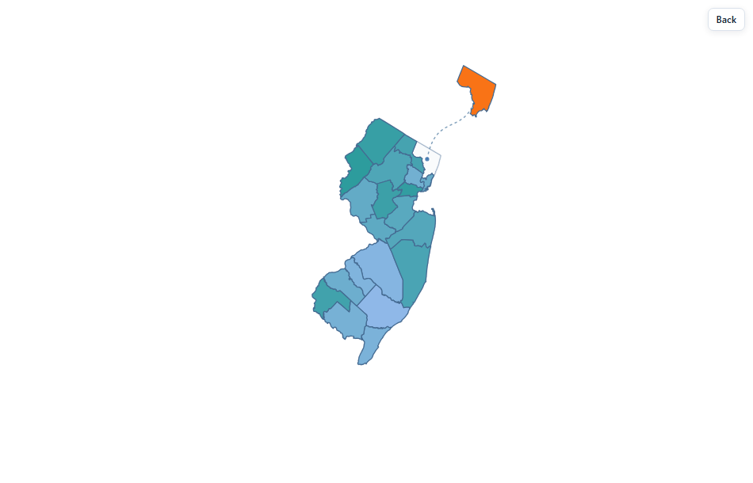

## Start with the defaults

```{r, eval=FALSE}
library(bloomr)
bloom_map()
```

The map has no surrounding card or full toolbar. It uses a light theme and displays original-location dots, dotted connectors, and the original geographic boundaries. Area names appear on hover. Labels are hidden by default to avoid clutter.

## Add a card and toolbar when useful

The map-only view fits directly into a dashboard or report. To show a bordered
card and full toolbar instead:

```{r, eval=FALSE}
bloom_map(appearance = "card", controls = TRUE)
```

With the default map-only view, click the map to bloom, select a region, and
double-click it or press Enter again to explore. A small **Explore** or **Back**
button appears when needed. Ctrl+mouse wheel zooms without blocking normal page
scrolling. The full toolbar remains available through `controls = TRUE`.

## Size the map and bloom

The output dimensions, starting map magnification, and bloom spacing are
separate controls:

```{r, eval=FALSE}
bloom_map("nj", width = "100%", height = "650px",
          map_zoom = 1.15, bloom_spread = 0.9)
```

`width` and `height` size the widget in an HTML report or the RStudio Viewer.
In Shiny, use `bloomOutput("map", height = "650px")` to size its container.
`map_zoom` enlarges the parent map and bloomed regions together at startup; with
`controls = TRUE`, Fit returns to that magnification. `bloom_spread` adjusts how far areas
separate without changing their geographic shapes. The default for both is `1`.
Values above `1` spread regions farther; large zoom and spread values can crop
the outer areas, so adjust them together. Viewers can still use Ctrl+mouse wheel
or the toolbar zoom buttons.

To enlarge just the moved shapes, keep the background map at its usual size and
set `bloom_scale` above `1`:

```{r, eval=FALSE}
bloom_map("nj", view = "state_county", bloom_areas = "bergen",
          bloom_color = "#F97316", bloom_scale = 1.35)
```



The default is `bloom_scale = 1`; accepted values are `1` through `1.6`.
It applies to moved counties or local areas, and leaves the parent map and
unmoved areas unchanged. The layout reserves space for enlarged shapes.
Dots and connectors remain at the original geographic anchors.

## Change the theme or animation

```{r, eval=FALSE}
bloom_map(theme = "dark")
bloom_map(theme = "auto")
bloom_map(duration = 350)
bloom_map(draggable = FALSE)
```

`theme = "auto"` follows the browser's color preference. Light mode remains the default. Use `dots = FALSE` or `connectors = FALSE` to hide the corresponding geographic guides.

## Show or hide boundaries

With `controls = TRUE`, the map's **Display** menu contains two separate controls:

- **Overview: county lines** shows the county outlines inside the original state map.
- **Local: municipality/subdivision lines** shows the outlines inside the selected county.

Both are on by default. To turn them off in R:

```{r, eval=FALSE}
bloom_map(overview_boundaries = FALSE)
bloom_map(local_boundaries = FALSE)
```

## Choose where local areas bloom

By default, local areas bloom from the original position of their parent. To
start at the parent's current expanded (or dragged) location instead:

```{r, eval=FALSE}
bloom_map(local_origin = "expanded")
```

With `controls = TRUE`, you can also switch **Bloom from expanded parent** in the **Display** menu
before opening the local view. Either choice keeps the reference boundaries,
origin dots, and dotted connectors aligned with the local map. Returning to
the parent uses the same smooth transition.

## Show a few labels

```{r, eval=FALSE}
bloom_map(labels = "selected")
bloom_map(labels = "all")
bloom_map(labels = "custom", label_areas = c("bergen", "essex"))
```

Use `"selected"` for the selected area, `"all"` for labels with basic overlap filtering, or `"custom"` to label particular IDs. Tooltips remain available in every mode. Shift+click an area, or focus it and press **L**, to add or remove its label.

## Keyboard controls

| Key | Action |
| --- | --- |
| Tab | Reach the map, active areas, and contextual controls |
| Arrow keys | Move focus between areas |
| Home / End | Go to the first or last area |
| Enter / Space | Bloom the focused state; select a focused county, then press again to explore its local areas |
| L | Show or hide the focused area's label |
| Escape | Close Display or return to the previous level |

The widget also respects the browser's reduced-motion preference. Keyboard navigation supports selecting regions; moving shapes by keyboard is not available.

## Indicator units

Give the color key a useful title and unit without changing the data:

```{r, eval=FALSE}
bloom_map("nj", data = rates, value = "rate",
          value_label = "Screening rate", value_suffix = "%")
```

The color key follows the values of the current map level.
